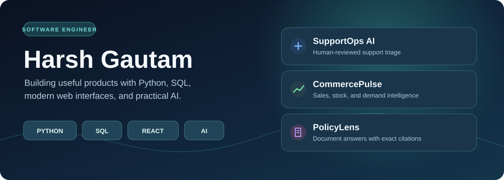

  

  # Harsh Gautam

  **Software engineer working across AI applications, web products, games, and systems.**

  [Browse all projects](#project-directory) · [Explore by discipline](#portfolio-map) · [LinkedIn](https://www.linkedin.com/in/harsh-gautam-70b1a6256/)

## Portfolio map

| Discipline | What you'll find | Start here |
| --- | --- | --- |
| **AI and intelligent interfaces** | Document search, grounded answers, local LLMs, AI-assisted workflows, and an embeddable website guide. | [PolicyLens](https://github.com/HARSH-1607/PolicyLens) · [Unity-LLM-Observer](https://github.com/HARSH-1607/Unity-LLM-Observer) |
| **Apps, web, and data** | APIs, SQL analytics, reactive interfaces, Android, dashboards, and data-driven UI. | [CommercePulse](https://github.com/HARSH-1607/CommercePulse) · [SupportOps AI](https://github.com/HARSH-1607/supportops-ai) |
| **Games and simulation** | Unity 2D/3D games, gameplay systems, simulation, and Unreal Engine prototypes. | [SpringStep](https://github.com/HARSH-1607/SpringStep) · [CyrusAssignment](https://github.com/HARSH-1607/CyrusAssignment) |
| **Systems and tooling** | C++ graph routing, concurrent indexing, and a standalone JavaScript asset. | [Graph Routing Engine](https://github.com/HARSH-1607/High-Performance-Graph-Routing-Engine-C-) · [File Indexer](https://github.com/HARSH-1607/Concurrent-High-Performance-File-Indexer-C-) |

## Selected work

| Project | What it demonstrates | Try it |
| --- | --- | --- |
| [**PolicyLens**](https://github.com/HARSH-1607/PolicyLens) | Document ingestion, FTS5 search, exact source citations, and answer evaluation. | [Live demo](https://policylens-demo.onrender.com/) |
| [**SupportOps AI**](https://github.com/HARSH-1607/supportops-ai) | Full-stack ticket operations, role-based access, dashboards, and human-reviewed AI triage. | [Live demo](https://supportops-ai-demo.onrender.com/) |
| [**CommercePulse**](https://github.com/HARSH-1607/CommercePulse) | Atomic order imports, SQL reporting, inventory tracking, forecasts, and sales alerts. | [Live demo](https://commercepulse-demo.onrender.com/) |
| [**Unity-LLM-Observer**](https://github.com/HARSH-1607/Unity-LLM-Observer) | A FastAPI/Ollama bridge that turns language into actions for a Unity environment. | [Repository](https://github.com/HARSH-1607/Unity-LLM-Observer) |
| [**SpringStep**](https://github.com/HARSH-1607/SpringStep) | A Unity 2D platformer with movement, combat, levels, and boss encounters. | [Play build](https://play.unity.com/en/games/705ef93a-807a-4ca3-856b-73f6e2e84597/springstep) |
| [**CyrusAssignment**](https://github.com/HARSH-1607/CyrusAssignment) | Unreal Engine C++ actor spawning from remote JSON with hit and score systems. | [Gameplay video](https://youtu.be/vApSTjAKpWs) |
| [**High-Performance Graph Routing Engine**](https://github.com/HARSH-1607/High-Performance-Graph-Routing-Engine-C-) | C++17 adjacency-list graph with Dijkstra and A* pathfinding. | [Repository](https://github.com/HARSH-1607/High-Performance-Graph-Routing-Engine-C-) |

The hosted AI and data demos use fictional content. The SupportOps demo is viewer-only, CommercePulse is read-only, and PolicyLens disables uploads and uses local extractive answers. Each repository explains its full local workflow.

## Project directory

Every public project repository is listed below. Forks are identified separately; this profile repository and private repositories are not project entries.

### AI and intelligent interfaces

| Repository | Focus |
| --- | --- |
| [PolicyLens](https://github.com/HARSH-1607/PolicyLens) | Question answering over documents with validated source citations and a small evaluation set. |
| [supportops-ai](https://github.com/HARSH-1607/supportops-ai) | Customer support platform with human-reviewed priority and duplicate suggestions. |
| [Unity-LLM-Observer](https://github.com/HARSH-1607/Unity-LLM-Observer) | Unity and local LLM integration through a Python API. |
| [vllm-chat-app](https://github.com/HARSH-1607/vllm-chat-app) | Local chat interface with vLLM, streaming output, and Docker setup. |
| [nova-web-guide-demo](https://github.com/HARSH-1607/nova-web-guide-demo) | Embeddable 3D website guide with chat, voice, and section navigation. |

### Apps, web, and data

| Repository | Focus |
| --- | --- |
| [CommercePulse](https://github.com/HARSH-1607/CommercePulse) | Sales and inventory dashboard with SQL reports and demand forecasting. |
| [Enterprise-Analytics-Dashboard](https://github.com/HARSH-1607/Enterprise-Analytics-Dashboard) | Angular dashboard with simulated telemetry and custom visualizations. |
| [Asynchronous-Interactive-Streaming-Platform](https://github.com/HARSH-1607/Asynchronous-Interactive-Streaming-Platform) | Angular/RxJS interactive streaming interface with WebSocket and fallback flows. |
| [Metadata-Driven-Dynamic-Form-Engine](https://github.com/HARSH-1607/Metadata-Driven-Dynamic-Form-Engine) | Angular reactive forms generated from runtime metadata. |
| [expense_tracker](https://github.com/HARSH-1607/expense_tracker) | React and TypeScript expense tracking dashboard. |
| [KoinX---Tax-Loss-Harvesting](https://github.com/HARSH-1607/KoinX---Tax-Loss-Harvesting) | React interface simulating tax-loss-harvesting calculations on crypto holdings. |
| [PayBhama](https://github.com/HARSH-1607/PayBhama) | Kotlin/Firebase Android payments app prototype. |
| [my-portfolio](https://github.com/HARSH-1607/my-portfolio) | Retro game-inspired personal portfolio website. |

### Games and simulation

| Repository | Focus |
| --- | --- |
| [Avatar](https://github.com/HARSH-1607/Avatar) | Unity avatar project with a Ready Player Me SDK dependency. |
| [Guns](https://github.com/HARSH-1607/Guns) | Unity first-person shooter prototype. |
| [Extinguish_UE5_Prototype](https://github.com/HARSH-1607/Extinguish_UE5_Prototype) | Unreal Engine atmospheric survival and exploration prototype. |
| [Unity-Elevator-Simulation](https://github.com/HARSH-1607/Unity-Elevator-Simulation) | Multi-elevator dispatch and floor-request simulation in Unity. |
| [unity-2d-slot-machine](https://github.com/HARSH-1607/unity-2d-slot-machine) | Unity 2D slot machine prototype with configurable outcomes and reel animation. |
| [card-kingdom-solitaire](https://github.com/HARSH-1607/card-kingdom-solitaire) | Unity card-game prototype with move rules, score, and win/loss flow. |
| [Ludo-Game-Unity](https://github.com/HARSH-1607/Ludo-Game-Unity) | Two-player Unity Ludo game with turns, captures, and complete UI flow. |
| [SpringStep](https://github.com/HARSH-1607/SpringStep) | Unity 2D action platformer with combat and boss fights. |
| [CyrusAssignment](https://github.com/HARSH-1607/CyrusAssignment) | Unreal Engine C++ technical project with JSON-driven spawning and scoring. |

### Systems and tooling

| Repository | Focus |
| --- | --- |
| [High-Performance-Graph-Routing-Engine-C-](https://github.com/HARSH-1607/High-Performance-Graph-Routing-Engine-C-) | C++17 graph routing with Dijkstra and A*. |
| [Concurrent-High-Performance-File-Indexer-C-](https://github.com/HARSH-1607/Concurrent-High-Performance-File-Indexer-C-) | C++17 thread pool and concurrent inverted index for document search. |
| [gl-eye-cdn](https://github.com/HARSH-1607/gl-eye-cdn) | Standalone minified JavaScript tracking asset. |

### Open source forks

| Repository | Focus |
| --- | --- |
| [Game_Scripts](https://github.com/HARSH-1607/Game_Scripts) | Fork of a community collection of small games in multiple languages. |
| [Hacktoberfest-2025](https://github.com/HARSH-1607/Hacktoberfest-2025) | Fork of a community web development and contributor project. |

## Technologies across the portfolio

| Area | Technologies used in these repositories |
| --- | --- |
| Backend, data, and AI | Python, FastAPI, SQLAlchemy, SQL, PostgreSQL, SQLite, scikit-learn, OpenAI API, Ollama, vLLM |
| Web and mobile | TypeScript, JavaScript, React, Angular, RxJS, HTML/CSS, Kotlin, Firebase |
| Games and systems | Unity, C#, Unreal Engine, C++, CMake |
| Delivery and tooling | Docker, GitHub Actions, Render |

  Interested in a particular discipline? Start with the portfolio map, then open a repository for the code, setup, and project-specific details.

